# Methodology diagram planner

This document is the production brief for a methodology figure covering the complete
seven-cohort spatial-proteomics project. It is intentionally more explicit than a
single overview graphic: the figure must show what is frozen before evaluation, what is
trained, what is only a control or comparison arm, and where each artifact is produced.

## 1. Figure objective

Communicate the following story in one left-to-right figure:

> Heterogeneous spatial-proteomics cohorts are converted into a common molecular and
> value representation; a fold-local label space and panel-aware encoder are learned
> without exposing the held-out cohort; transfer is evaluated by seven-fold LOCO and
> compared with controls, ablations, and MAPS.

The figure should answer four questions without relying on the caption:

1. What enters the pipeline?
2. Which transformations make cohorts comparable?
3. Which artifacts are built once versus rebuilt inside each evaluation fold?
4. What is the primary prediction and how is it judged?

## 2. Recommended canvas and visual grammar

- **Format:** landscape, 16:9, suitable for a thesis page or a slide.
- **Main flow:** five horizontal sections, connected left to right.
- **Evaluation loop:** a large inset around the model-training and scoring section.
- **Color groups:**
  - blue = observed data and cohort metadata;
  - teal = frozen harmonisation artifacts;
  - purple = learned representation and models;
  - orange = evaluation, controls, and external comparison;
  - gray = gates, reports, and reproducibility checks.
- **Line styles:**
  - solid arrow = data or artifact dependency;
  - dashed arrow = comparison/control arm;
  - dotted boundary = fold-local scope;
  - red warning badge = leakage or interpretation constraint.
- Put the artifact filename below each major node in small monospace text.
- Use “native”, “harmonized”, and “reference” as visibly distinct labels. Never call the
  harmonized space “ground truth” or “correct labels”.

## 3. Main overview diagram

The following Mermaid draft is a structural specification. It can be redrawn in
Illustrator, Figma, Inkscape, or diagrams.net without changing the node names or arrows.

```mermaid
flowchart LR
    D["7 spatial-proteomics cohorts<br/>CODEX · IMC · MIBI-TOF<br/>6.06M cells · native labels · coordinates"]
    P["Declarative loading<br/>standard table<br/>cell, cohort, image, patient, x/y,<br/>area, native label, markers"]
    I["Marker identity resolution<br/>canonical triple:<br/>gene/complex · epitope · modification"]
    V["Value harmonisation<br/>cohort-level mid-rank ECDF<br/>40,000-cell stratified tables"]
    L["Derived label space<br/>marker signatures, graph, prototypes<br/>whole-roster artifact for inspection"]
    W["Frozen marker vocabulary<br/>109 slots + panel masks<br/>wide value tables"]
    C["Per-cell confidence<br/>label-confidence sidecars"]
    F["Fold-local preparation<br/>6 training cohorts per LOCO fold<br/>patient split: train / val / test"]
    N["Full-table spatial graph<br/>15 nearest neighbours"]

    subgraph E["For each of 7 LOCO folds"]
        H["Held-out cohort<br/>never used for fitting or selection"]
        S["Fold-local label space<br/>training cohorts only"]
        M["Masked-marker pretraining<br/>measured / hidden / absent tokens"]
        R["Panel-aware set encoder<br/>109-token representation z"]
        T["Prototype classifier<br/>derived-space targets"]
        A["Optional arms and controls<br/>batch adversary · spatial context<br/>loss ablations · shuffle control"]
        Q["Score held-out cohort once<br/>macro-F1, kappa, calibration,<br/>risk-coverage, per-platform reports"]

        H -. "admission by marker evidence;<br/>NOVEL remains out of closed-set score" .-> S
        S --> T
        M --> R --> T
        N -. "same-image neighbours" .-> A
        R --> A --> Q
        T --> Q
    end

    X["Controls and comparisons<br/>random / majority · marker distance<br/>permuted labels / markers · MAPS"]
    G["Pre-registered gates<br/>0, 0b, 1, 1b, 1b-fold, 2, 3, 4, 6, 10"]
    O["Outputs<br/>reports · checkpoints · gate verdicts<br/>golden reproducibility test"]

    D --> P --> I --> V --> L --> W --> F
    W --> C
    F --> S
    V --> M
    W --> M
    W --> R
    F --> H
    X -. "same folds, cells, splits, and metrics" .-> Q
    G -. "checks each stage and fold" .-> O
    Q --> O
    L --> O

    classDef data fill:#dceeff,stroke:#2878b5,color:#102a43;
    classDef frozen fill:#d9f3ee,stroke:#198f7a,color:#123b35;
    classDef model fill:#eadcff,stroke:#7547a8,color:#28143d;
    classDef eval fill:#ffe7c2,stroke:#c77800,color:#4a2b00;
    classDef report fill:#eeeeee,stroke:#777,color:#222;
    class D,P data;
    class I,V,L,W,C,F,N frozen;
    class H,S,M,R,T,A model;
    class Q,X eval;
    class G,O report;
```

## 4. Expanded LOCO inset

The overview should be accompanied by a small numbered inset, or by callouts on the
large fold boundary:

1. **Select one held-out cohort.** Repeat for CRC, UPMC, Keren, Ferguson, Phillips,
   Danenberg, and Sorin.
2. **Build the fold-local label space from the other six cohorts.** The held-out cohort
   cannot contribute to clustering, prototypes, cut selection, or label admission.
3. **Split training cohorts by patient** into 68% train, 12% validation, and 20% test.
   No patient may cross a split. Record the split fingerprint in every checkpoint.
4. **Warm-start only from a checkpoint trained on a subset of the six training cohorts.**
   Loading an all-seven-cohort checkpoint is a leakage error.
5. **Fit model and select settings on training/validation patients.**
6. **Map held-out labels by marker evidence.** Labels without an admissible match are
   marked `NOVEL` and excluded from the closed-set score rather than forced into a class.
7. **Score the held-out cohort once.** Aggregate across seven folds and report uncertainty;
   with seven folds, a method improvement is claimed only when the declared interval
   excludes zero.

 Add a red callout beside the loop:

> **Leakage barrier:** all label-touching and learned artifacts inside the loop are
> fold-local. The 109-marker vocabulary is frozen globally before model evaluation, but
> fold-local label spaces and warm starts must exclude the held-out cohort.

## 5. Node checklist for the final artwork

| ID | Diagram node | Must show | Artifact or evidence |
|---|---|---|---|
| D | Cohort intake | 7 cohorts, 3 platforms, tissue/panel/value/label heterogeneity | `Datasets/` |
| P | Standardise | one generic loader; all cells retained initially | `work/raw/{cohort}.parquet` |
| I | Molecular identity | triple, not gene/name alone; non-protein channels excluded | `work/marker_registry.csv` |
| V | Value scale | per-cohort mid-rank ECDF; stratified 40k tables | `work/values/{cohort}.parquet` |
| L | Label hypothesis | marker-signature graph and prototypes; no hand mapping | `work/label_map.csv`, `prototypes.npy` |
| W | Panel-aware input | 109 frozen vocabulary slots; absent is not zero | `work/panel.json`, full tables |
| C | Confidence | sidecar metadata, not a replacement for labels | `work/label_conf/` |
| F | Fold setup | fold-local spaces and patient-level splits | `work/spaces/`, split fingerprint |
| N | Spatial context | full raw tables, not 40k subsamples, for neighbours | `work/values/{cohort}_neighbours.npz` |
| M | Pretraining | masked-marker reconstruction; no labels in the objective | `work/ckpt/pretrain_*.pt` |
| R/T | Main model | set encoder, prototypes, harmonized targets | classifier checkpoints |
| A | Investigational arms | adversary and spatial context as tested comparisons, not assumed gains | encoder/spatial checkpoints |
| Q | Evaluation | LOCO held-out score and declared metrics | gate reports |
| X | Comparison arms | controls, negative controls, marker-distance, MAPS | external/comparison reports |
| O | Reproducibility | pre-registered gates, hashes, golden test, reports | `reports/`, `tests/golden.py` |

## 6. Scope boundaries to draw explicitly

### In scope

- Seven public cancer cohorts: CRC, UPMC, Keren, Ferguson, Phillips, Danenberg, and
  Sorin.
- Primary seven-fold **LOCO** evaluation.
- Secondary five-fold **LOTO** tissue evaluation, shown as a small branch from the same
  frozen preprocessing and evaluation machinery. Breast and skin are the true
  multi-cohort tissue holdouts; singleton-tissue folds equal their LOCO folds.
- CPU preprocessing, GPU model stages, result import, and final comparison/reporting.

### Do not imply

- The whole-roster label space is blind to a held-out cohort; it is an inspection/build
  artifact, not the LOCO headline space.
- Native labels are **not** ground truth; they are raw inputs whose annotation error must
  remain visible.
- Reference resources such as Cell Ontology and CellMarker 2.0 are training inputs;
  they are evaluation-only.
- Spatial context or the batch adversary improved transfer. They are experimental arms,
  and the project reports no measurable gain.
- The 109-slot vocabulary was rebuilt inside every fold; it is frozen once, while label
  spaces and learned weights are fold-local.
- The model does **not** use zero-filled unmeasured markers; it uses an explicit
  absent-marker state instead.

## 7. Gate and reporting strip

Place a thin gray strip under the main flow with these milestones:

`Gate 0` load audit → `Gate 0b` marker identity → `Gate 1` value bake-off →
`Gate 1b / 1b-fold` label spaces → `Gate 2` masked pretraining →
`Gate 6` classifier/losses → `Gate 3` adversary → `Gate 4` spatial context →
`Gate 10` external MAPS comparison.

Mark each gate as **pre-registered**, and use a separate badge for waived failures.
Do not encode a waived gate as a clean pass. The caption should state that reports retain
failed attempts, replacements, waivers, and post-hoc `nearest_feasible` fold flags.

## 8. Suggested caption

**Methodology overview.** Seven heterogeneous spatial-proteomics cohorts are loaded into
a common cell table, resolved to canonical marker triples, and harmonized with
cohort-level rank transforms. A frozen 109-marker vocabulary represents measured,
masked, and never-measured markers distinctly. For each leave-one-cohort-out fold, a
label space, patient-level splits, warm start, classifier, and optional encoder/spatial
arm are built without the held-out cohort. Held-out native labels are admitted by marker
evidence or marked `NOVEL`, and the cohort is scored once. Controls, negative controls,
and the published MAPS baseline use the same folds and metrics. Pre-registered gates,
artifact hashes, and the golden test provide reproducibility checks.

## 9. Production checklist

- [ ] Verify every artifact filename against the current `celltype_transfer/run.py`.
- [ ] Use the same seven cohort names and platform/tissue labels as the registry.
- [ ] Draw the LOCO boundary around fold-local label spaces, warm starts, and models.
- [ ] Add the LOTO branch without presenting it as the primary result.
- [ ] Add an explicit absent-marker token and a crossed-out zero-fill shortcut.
- [ ] Add a crossed-out hand-written label map.
- [ ] Label reference resources as evaluation-only.
- [ ] Show controls and MAPS with dashed comparison arrows.
- [ ] Include gate IDs and distinguish PASS, FAIL, and WAIVED in the legend.
- [ ] Test the exported figure at thesis-column width; all artifact labels must remain legible.
